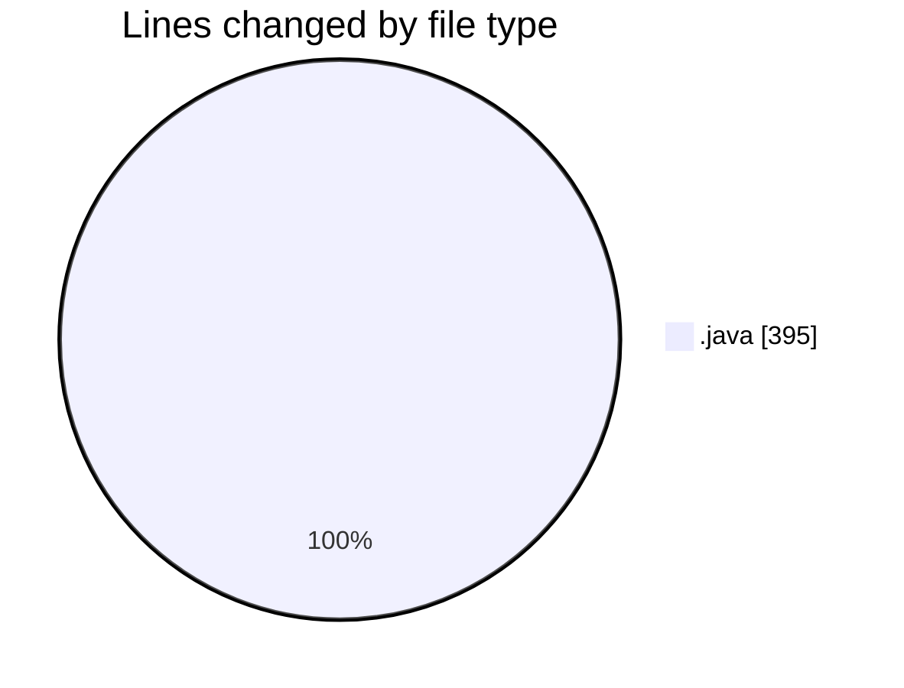
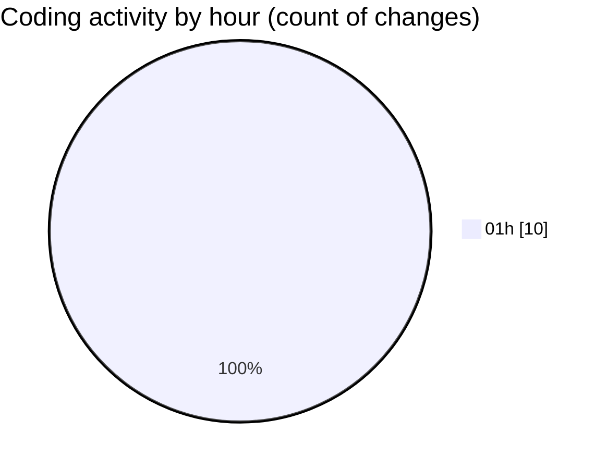

# TaskForge - Activity Summary 

## Overall Statistics

| Stat                   | Value                                                             |
| ---------------------- | ----------------------------------------------------------------- |
| **Lines Added** (➕)   | 210                                          |
| **Lines Removed** (➖) | 185                                        |
| **Net Change** (↕)    | 25                |
| **Active Time** (⌚)   | 19 minutes |

## Modified Files
- **UserRole.java** (+8, -0)
- **Project.java** (+2, -0)
- **Comment.java** (+1, -0)
- **Task.java** (+0, -3)
- **BackendApplication.java** (+182, -182)
- **TaskPriority.java** (+9, -0)
- **Role.java** (+8, -0)

## Visualizations

### By File Type (Lines Changed)

### By Hour (Estimated Activity Count)

> **Last Updated:** 11/6/2026, 1:41:36 AM